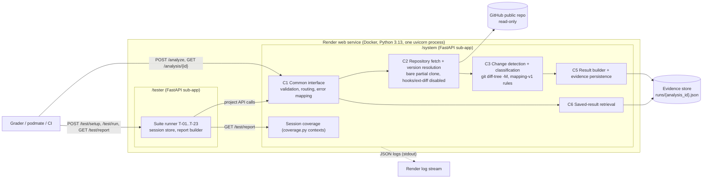
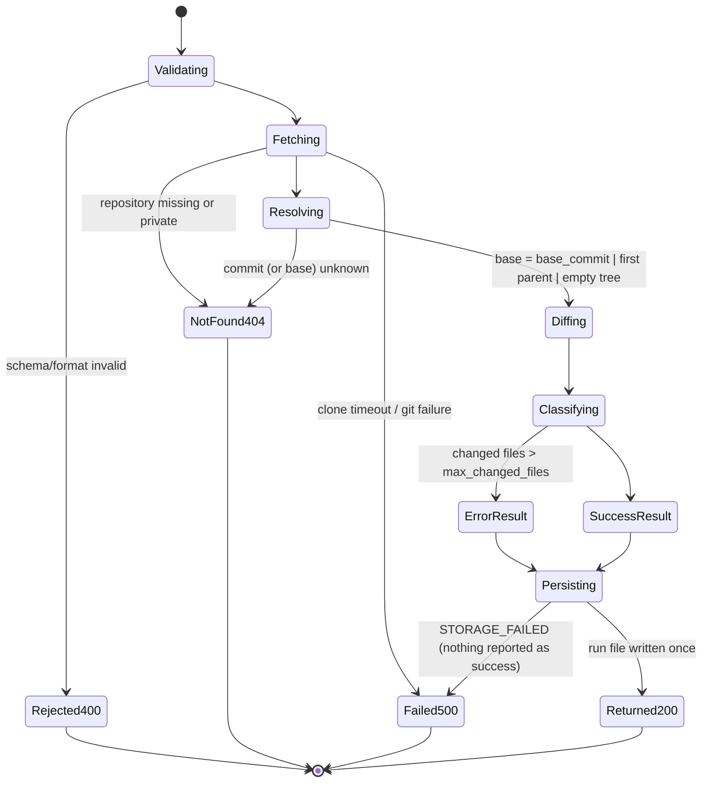
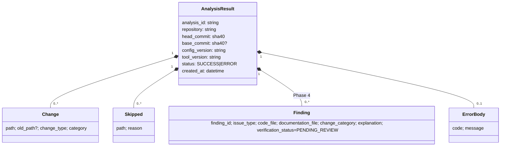
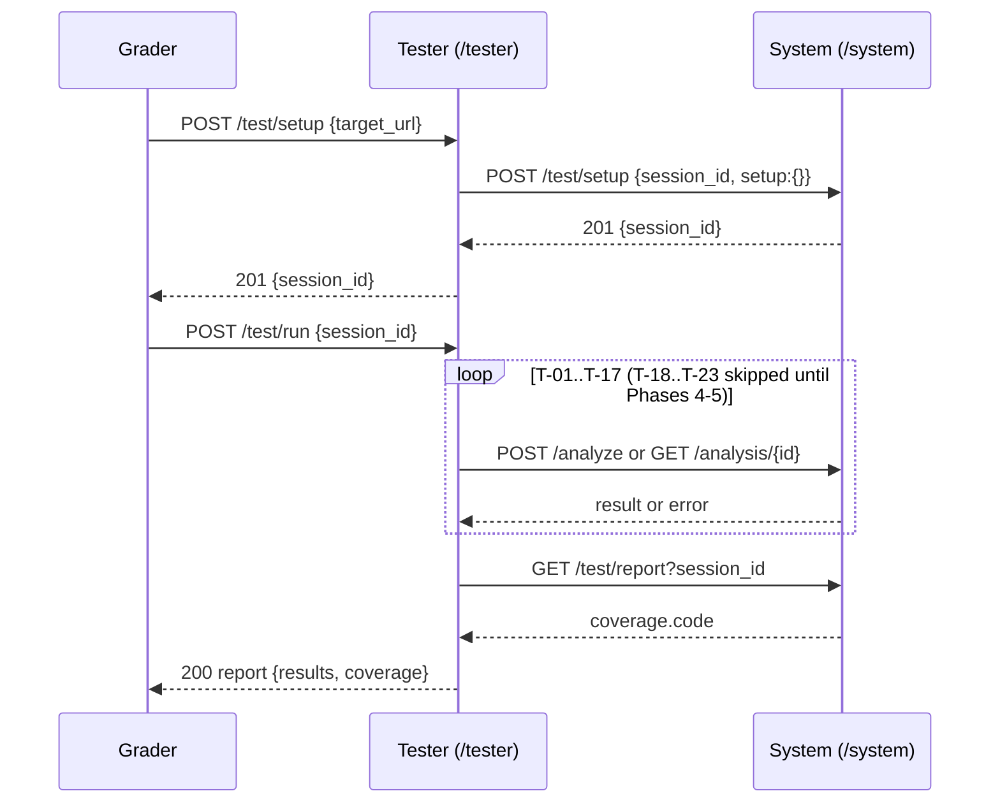

# Documentation Tracker: system as delivered (v0.3.0, Phase 3)

## 1. Delivered capability

Through the pod's common interface a user can submit a public GitHub repository and commit, have the service resolve the base version (first parent when `base_commit` is omitted, empty tree for a root commit), receive every changed path classified under the shared `mapping-v1` rules, and later retrieve the identical saved result by `analysis_id`. Invalid input, missing repositories/commits and storage failures return explicit errors. Documentation findings (`issues`) are always empty in this increment; detection is the Phase 4 milestone.

## 2. Interface

| Operation | Purpose | Success | Errors |
|---|---|---|---|
| `POST /analyze` | Analyze `commit_id` against `base_commit` or its first parent | 200 `AnalysisResult` | 400 `INVALID_REQUEST`, 404 `REPOSITORY_NOT_FOUND` / `COMMIT_NOT_FOUND`, 500 `ANALYSIS_FAILED` / `STORAGE_FAILED` |
| `GET /analysis/{analysis_id}` | Retrieve a saved result unchanged | 200 `AnalysisResult` | 404 `ANALYSIS_NOT_FOUND`, 500 `STORAGE_FAILED` |
| `POST /test/setup` (system) | Start a coverage-measured session | 201 `{session_id}` | 400, 409 duplicate, 500 `{message, source}` |
| `GET /test/report` (system) | Line coverage for the session | 200 `{session_id, coverage.code}` | 400, 404 |
| `POST /test/setup` (tester) | Create session, call system setup | 201 `{session_id}` | 400; forwarded system status/message/source; 500 `communication` |
| `POST /test/run` (tester) | Run T-01..T-23 in order, return report | 200 report | 404 unknown, 409 already run, 500 abort |
| `GET /test/report` (tester) | Stored report | 200 report | 400, 404, 409 not finished |

Project errors use `{code, message}` (Phase 2, Section 5.2). Testing-interface errors use `{message, source}` (course spec). Full schemas: `openapi/system.openapi.json`, `openapi/tester.openapi.json`.

`AnalysisRequest`: `repository` (string, `owner/name`, required), `commit_id` (7 to 40 hex, required), `base_commit` (7 to 40 hex, optional). Unknown fields are ignored.

`AnalysisResult`: `analysis_id` (`an-` + 32 hex), `repository`, `head_commit` and `base_commit` (full 40-char SHAs; `base_commit` null for a root commit), `config_version`, `tool_version`, `status` (`SUCCESS` or `ERROR`), `error` (null or `{code, message}`), `issues[]`, `changes[]` (`path`, `old_path`, `change_type` in ADDED/MODIFIED/DELETED/RENAMED/COPIED/TYPE_CHANGED, `category`), `skipped[]` (`path`, `reason`), `created_at` (ISO 8601 UTC). Changes are sorted by path so repeated runs are byte-identical apart from `analysis_id` and `created_at`.

## 3. Models

### 3.1 Architecture and data flow (component diagram)

Pod components C4 (documentation rule detector) and C7 (review workflow) are specified but not yet implemented, so they are not drawn.

### 3.2 Analysis lifecycle (state machine)

### 3.3 Classification decision model (mapping-v1)

Rules are evaluated top to bottom; first match wins: REQUIREMENT, SPECIFICATION, ARCHITECTURE, DESIGN, IMPLEMENTATION, else OTHER. Changed files whose extension is not in `supported_extensions` are still listed in `changes` and also in `skipped` with `UNSUPPORTED_FILE_TYPE`. See `doctracker/system/mapping-v1.yaml`.

### 3.4 Information model

### 3.5 Cross-team test sequence

## 4. Testing-interface rules (pod preparation, resets, cleanup)

- System setup takes `setup: {}`; no starting data is needed because analyses read only the public fixture repository.
- Sessions may be set up concurrently, but code coverage is attributed to the most recently set-up session. Run one suite at a time for accurate coverage.
- Sessions and tester reports are held in memory and cleared by a restart. Evidence run files are never deleted or overwritten.
- Limits to register: tester setup 90 s (includes a free-tier cold start), tester run 600 s, system setup 90 s.

## 5. Components and acceptance criteria used for coverage

| ID | Component | Phase |
|---|---|---|
| C1 | Common web-service interface | 3 |
| C2 | Read-only repository fetch and version resolution | 3 |
| C3 | Change detection and classification | 3 |
| C4 | Mapping and documentation rule detector | 4 |
| C5 | Result builder and evidence persistence | 3 |
| C6 | Saved-result retrieval | 3 |
| C7 | Authorized review workflow | 5 |

System coverage counts AC-01..AC-10 (Phase 2, Section 4.1) exercised by at least one executed test.

## 6. Known limitations

| ID | Limitation | Affects | Severity | Target |
|---|---|---|---|---|
| LIM-01 | No documentation findings yet; `issues` is always `[]` | REQ-02, AC-02/03/04 | high | 4 |
| LIM-02 | Free Render instance sleeps after ~15 min idle; first request can take about a minute | all operations | medium | 6 |
| LIM-03 | Without `EVIDENCE_REPO`, run files live on the container disk and are lost on redeploy/restart | REQ-04, AC-06 | medium | 4 |
| LIM-04 | Code coverage is attributed to the latest session; concurrent suites blur per-session numbers | /test/report | low | 5 |
| LIM-05 | Public GitHub repositories only; clone timeout 60 s, more than 2000 changed files returns an ERROR result | REQ-01, REQ-05 | low | 6 |
| LIM-06 | No reviewer authorization or review records | REQ-03, REQ-06, AC-05 | high | 5 |
