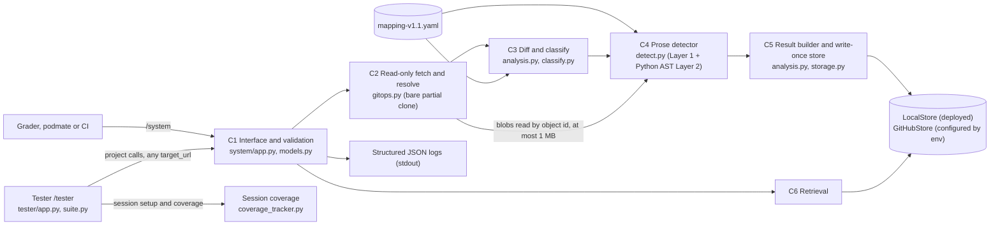
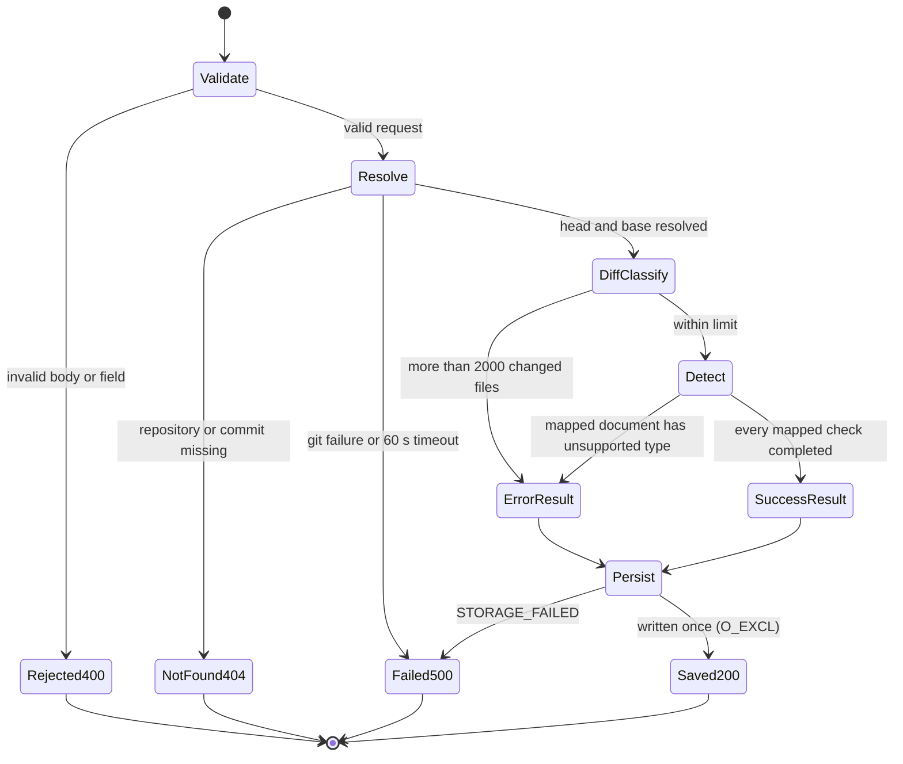
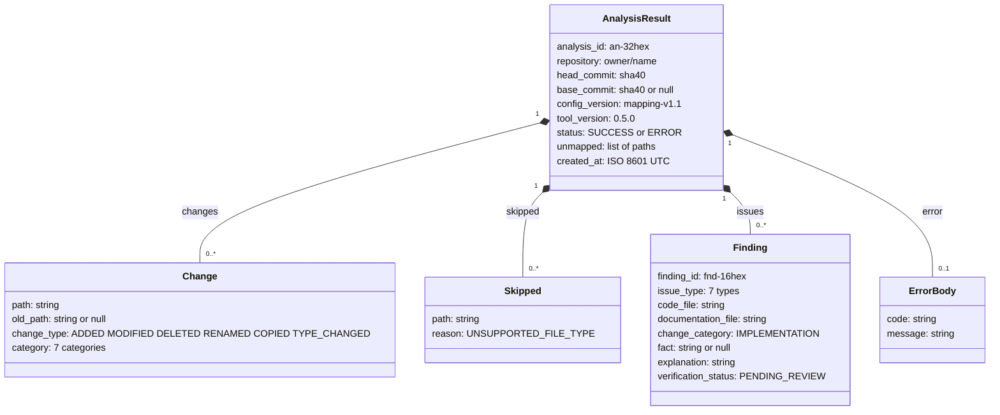
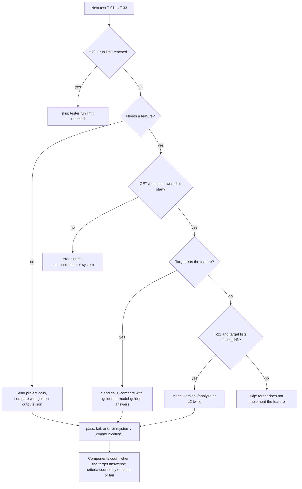

# Documentation Tracker: system as delivered (v0.5.0)

Team 16, Pod 15/16. Deployed at https://doc-tracker-team16.onrender.com (`/system`, `/tester`).
Release: tag `v0.5.0` (commit 35e875c). Pod specification: [contract 2.5.0](contract/pod-contract.md),
[v1.1 SPEC](contract/spec-v1.1.md), [mapping-v1.1](contract/mapping-v1.1.yaml).

## 1. What the system does

`POST /system/analyze` takes a public GitHub repository (`owner/name`), a commit and an
optional base. It resolves the base (first parent, or the empty tree for a root commit),
lists every changed file with `git diff-tree -r -M`, classifies each path under
`mapping-v1.1`, runs the prose documentation detector on mapped implementation files and
saves the result once. `GET /system/analysis/{id}` returns that saved result unchanged.
`GET /system/health` lists `features: ["prose_detector"]`.

The detector flags documentation drift for people to review. It never decides that a
document is correct, and every finding starts `PENDING_REVIEW`.

## 2. Interface (contract 2.5.0)

| Operation | Success | Errors |
|---|---|---|
| POST /system/analyze | 200 AnalysisResult (`status` SUCCESS, or ERROR with `CHANGE_LIMIT_EXCEEDED` / `MAPPING_UNSUPPORTED`) | 400 INVALID_REQUEST; 404 REPOSITORY_NOT_FOUND, COMMIT_NOT_FOUND; 500 ANALYSIS_FAILED, STORAGE_FAILED |
| GET /system/analysis/{analysis_id} | 200 the saved result, unchanged | 404 ANALYSIS_NOT_FOUND; 500 STORAGE_FAILED |
| GET /system/health | 200 status, tool_version, config_version, storage, features | none |
| POST /system/generate | not implemented (optional, `model_drift` only) | |
| POST /system/test/setup | 201 session_id | 400; 409 duplicate id or another session active (until its report is read, at most 720 s); 500 |
| GET /system/test/report | 200 coverage.code for the session | 400; 404; 409 preparing; 500 |
| POST /tester/test/setup | 201 session_id | 400; system failure forwarded; 500 communication |
| POST /tester/test/run | 200 suite report (T-01 to T-33) | 404; 409 already run; 500 run limit reached |
| GET /tester/test/report | 200 stored report | 400; 404; 409 not finished |

FastAPI's default 422 is replaced by 400 INVALID_REQUEST. Field names and enums follow
[pod-contract.openapi.yml](contract/pod-contract.openapi.yml); the generated documents are in
[openapi/](../openapi/).

## 3. Models

### 3.1 Architecture and data flow

C7 (authorized review workflow) is not implemented and is not drawn. Only C2 reaches
GitHub, only C5 writes, and no repository file is checked out, imported or executed.

### 3.2 Analysis lifecycle

### 3.3 Classification and detection decision model

Classification: first matching rule wins, in the order REQUIREMENT, SPECIFICATION,
ARCHITECTURE, DESIGN, IMPLEMENTATION, DOCUMENTATION, else OTHER. Binary and other
unsupported files are listed in `skipped` with `UNSUPPORTED_FILE_TYPE`.

Detection, for each changed IMPLEMENTATION path:

| Condition | Result |
|---|---|
| No mapping entry, and the path was added or modified | listed in `unmapped`; no finding |
| Mapped document has an unsupported extension | saved ERROR, `MAPPING_UNSUPPORTED` |
| Source deleted and its document still exists | ORPHANED_DOCUMENTATION |
| Document absent at head | MISSING_DOCUMENTATION |
| Document exists but did not change in the diff | OUTDATED_DOCUMENTATION |
| Python source: new public function, class or UPPER_CASE constant not named in the document | UNDOCUMENTED_SYMBOL (fact = name) |
| Removed symbol still named in the document | STALE_REFERENCE |
| Parameter added and not named, or removed and still named | STALE_SIGNATURE (fact = function.param) |
| Constant value changed and the document still shows the old value or lacks the new one | STALE_VALUE |

Layer 2 parses Python with `ast.parse` and `ast.literal_eval`; it never imports or runs
the code. `finding_id = "fnd-" + sha256("{head}|{type}|{code}|{doc}|{fact or ''}")[:16]`.

### 3.4 Information model

### 3.5 Tester: one test's outcome (contract 2.5.0, sections 4 and 5)

T-18 to T-21 need `prose_detector`; T-22 to T-33 need `model_drift`. On our system the
tester therefore runs 21 tests and skips 12; on Team 15's system it runs 30 and skips 3.

## 4. Sessions, storage and observability

- One test session at a time; coverage counts only lines run while that session is active.
  Sessions and tester reports are in memory and clear on restart.
- Saved results are write-once JSON files. The deployment uses LocalStore on Render's
  container disk, so a redeploy or instance replacement loses them. GitHubStore
  (`EVIDENCE_REPO`, `EVIDENCE_TOKEN`) writes to a separate evidence repository and is
  enabled only through Render secrets.
- No credentials are needed to analyze public repositories; none are in source or logs.
- Every analysis logs one JSON line at start, stop or completion with analysis ID,
  commits, stage, status, counts, storage backend and duration. Render health-checks
  `/system/health`.

## 5. Known limitations

| ID | Limitation | Affects |
|---|---|---|
| LIM-01 | No authorized review workflow (C7); findings stay PENDING_REVIEW | REQ-03, AC-05 |
| LIM-02 | No `model_drift`: T-22 to T-33 skip on this system, so the pod suite covers 8 of 10 criteria (not AC-05, AC-09) | REQ-03, REQ-06 |
| LIM-03 | Saved results live on the container disk and are lost on redeploy | REQ-04, AC-06 |
| LIM-04 | Free Render instance sleeps after 15 idle minutes; first request can take about 50 s | all |
| LIM-05 | Explicit mappings only; unmapped implementation files get no findings; Layer 2 is Python only | REQ-02 |
| LIM-06 | One test session at a time (409 for up to 720 s) | testing interface |
| LIM-07 | Public repositories only; 2000 changed files; 1 MB per mapped file; 60 s per git command | REQ-01, REQ-05 |
| LIM-08 | CI's deployed-suite job targets doc-tracker-5t4s until the DEPLOY_BASE_URL variable is changed | release checks |

The local pytest suite assumes Linux paths (`tests/conftest.py`); CI runs it on Ubuntu.
