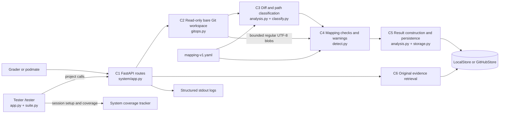
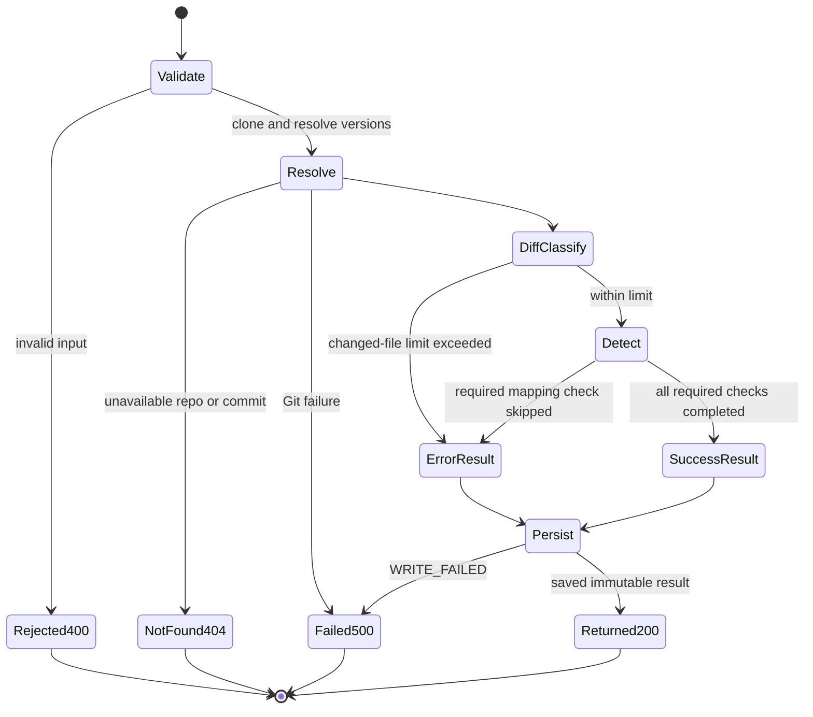
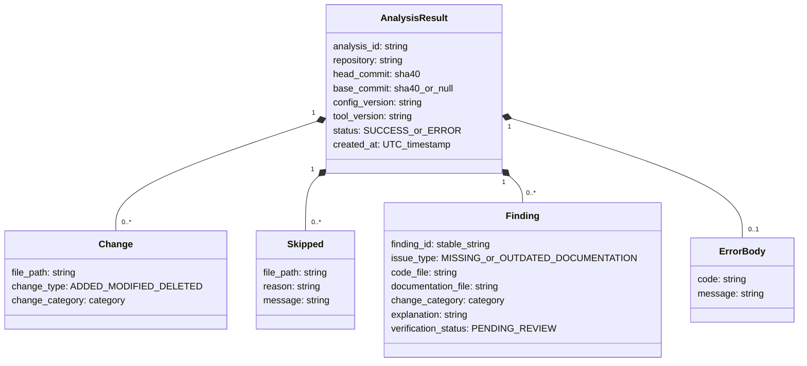
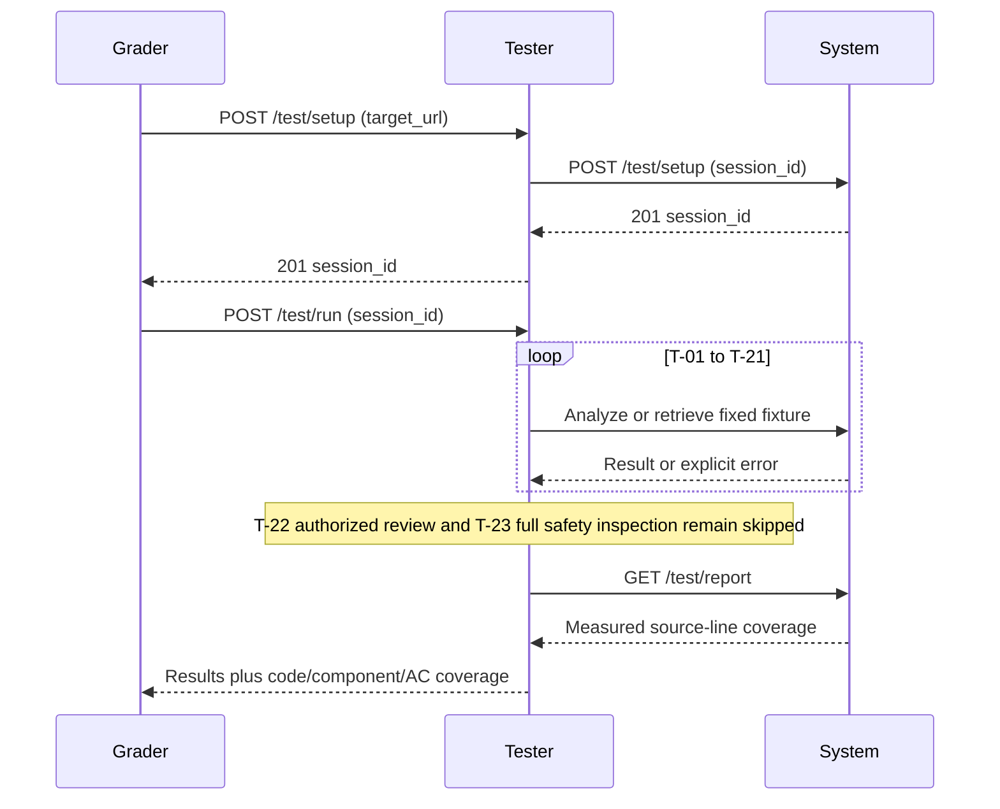

# Documentation Tracker: implemented Phase 4 increment (v0.4.0)

This describes the source on the Phase 4 branch. A version bump is not proof of
release: see [release verification](RELEASE.md) and [validation](VALIDATION.md).
The previously observed public deployment was v0.3.0 with local storage.

## 1. Delivered code capability

`POST /analyze` resolves a public repository's head/base commits, classifies changes,
applies explicit `mapping-v1` source/documentation pairs and saves a separate result.
A changed mapped source produces `MISSING_DOCUMENTATION` when its document is absent
at head, or `OUTDATED_DOCUMENTATION` when the document exists but is unchanged in the
diff. Findings have stable IDs and start `PENDING_REVIEW`. `GET /analysis/{id}` returns
the original evidence unchanged. This is a file co-change heuristic, not a check of
semantic correctness or legal compliance. See [mapping investigation](MAPPING_INVESTIGATION.md).

## 2. Interface and compatibility

The Phase 2 Version 1 contract is the baseline; the October 18 v1.1 proposal has no
verified pod approval. v0.4.0 corrects the v0.3.0 deviations instead of adopting it.

| Operation | Success/result | Errors |
|---|---|---|
| POST /analyze | 200 AnalysisResult; SUCCESS or a saved ERROR | 400 INVALID_REQUEST; 404 REPOSITORY_NOT_FOUND/COMMIT_NOT_FOUND; 500 ANALYSIS_FAILED/WRITE_FAILED |
| GET /analysis/{analysis_id} | 200 original saved result, including ERROR and historical schemas | 404 ANALYSIS_NOT_FOUND; 500 READ_FAILED |
| POST /test/setup (system) | 201 session_id | 400 validation; 409 duplicate; 500 setup |
| GET /test/report (system) | 200 session_id and coverage.code | 400 missing session; 404 unknown |
| POST /test/setup (tester) | 201 session_id | 400 validation; forwarded system failure; 500 communication |
| POST /test/run (tester) | 200 report | 404 unknown; 409 already run; 500 aborted |
| GET /test/report (tester) | 200 stored report | 400 missing; 404 unknown; 409 unfinished |

Project errors have `code,message`; course testing errors have `message,source`.
The generated [OpenAPI contracts](../openapi/) describe the new response shape.

Changes now use `file_path,change_type,change_category`. Rename becomes deletion
plus addition; copy becomes addition; type change becomes modification. Skips use
`file_path,reason,message`; reasons include INVALID_MAPPING, UNSUPPORTED_FILE and
FILE_UNREADABLE. Required mapping failures save `status=ERROR,error.code=CHECKS_SKIPPED`.
Unmapped unsupported changes are informational skips and do not invalidate required checks.
Clients using v0.3.0 `path/category/old_path`, RENAMED or STORAGE_FAILED must migrate.
Historical evidence is returned verbatim, not coerced to the new schema.

## 3. Engineering models and code correspondence

### 3.1 Architecture and data flow

C4 is now implemented. C7 authorized review remains Phase 5 and is intentionally
excluded from the implemented architecture. GitHubStore exists but is active only
when deployment credentials are configured; a local filesystem on free Render is
not durable across container loss. No reviewed code is checked out or executed.

### 3.2 Analysis lifecycle

`SUCCESS` means applicable checks completed, not that documentation is correct.
Both completed result statuses are saved before returning. Partial findings may
coexist with explicit skipped checks in an ERROR result.

### 3.3 Classification and detection decision model

Classification uses first match: REQUIREMENT, SPECIFICATION, ARCHITECTURE, DESIGN,
IMPLEMENTATION, then OTHER. Exact mappings are deduplicated and sorted.

| Condition | Outcome |
|---|---|
| Invalid mapping structure/path or source equals document | INVALID_MAPPING skip; saved ERROR |
| Valid mapped source not changed | No finding/check for that pair |
| Required source or document type unsupported | UNSUPPORTED_FILE skip; saved ERROR |
| Present mapped file is a symlink, directory, submodule, binary, invalid UTF-8, unreadable, or larger than 1 MB | FILE_UNREADABLE skip; saved ERROR |
| Changed mapped source and document absent at head | MISSING_DOCUMENTATION; PENDING_REVIEW |
| Changed mapped source and document unchanged | OUTDATED_DOCUMENTATION; PENDING_REVIEW |
| Changed mapped source and readable document changed too | No warning; semantic correctness unknown |
| Source deleted/renamed | Read source at base if absent at head; still evaluate its mapping |
| Unmapped unsupported changed path | Informational skip; no required mapping failure |

Paths must be exact relative paths, without traversal, globs, backslashes or control
characters. Git reads regular blobs by object ID without checkout or symlink following.

### 3.4 Information model

`models.py` defines these response schemas. `detect.py` now creates Finding values;
`analysis.py` includes them in persisted results. IDs hash mapping version, source,
document and issue type, so equivalent findings are stable across runs. Parent
results hold the resolved commit linkage. Confidence is omitted, not fabricated.
Review records remain planned and do not overwrite these results.

### 3.5 Tester interaction

## 4. Sessions, storage and observability

Sessions/reports are in memory and reset on process restart. Local run files are
write-once; restart preserves them only if their directory persists. GitHubStore
writes to a separate evidence repository. Do not store credentials in source,
logs, responses or the analyzed repository. Do not delete evidence to reset tests.
Run test sessions serially: current coverage attribution follows the latest setup.
Logs record analysis ID, resolved commits, status, counts, storage and duration.
Use health, tester report and saved evidence together; health alone is not acceptance.

## 5. Coverage meaning and remaining limitations

C1-C6 are implemented; C7 is not. The network suite exercises AC-01/02/03/04/06/07/08/10,
which is eight criteria touched, not eight criteria fully demonstrated. Restart
proof is additionally required for AC-06, fault injection for AC-08 and human
inspection for AC-04. Local tests cover mapped binary/invalid files and read-only
blob access; T-23 remains skipped because the full deployed safety inspection is
not performed by that network test. Cross-team outcomes must be recorded separately.

Remaining: semantic false negatives under co-change; explicit mappings cover only
three paths; no authorized review workflow; optional GitHub backend must be
configured and restart-tested; local free-host storage can be lost; cold starts;
2,000-change and 60-second Git command limits; 1 MB mapped-text limit; contract
migration and updated fixture expectations require pod communication.
